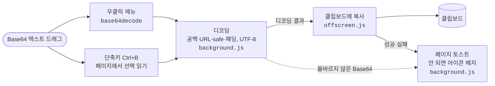

# Base64 Decode & Copy

[English](README.md) | **한국어**

드래그한 Base64 문자열을 우클릭 메뉴 한 번으로 디코딩해 클립보드에 복사하는 크롬 확장프로그램입니다.

## 기능

- 텍스트를 드래그한 뒤 우클릭 → **base64decode** 클릭 → 디코딩 결과가 클립보드에 복사됨
- 단축키 **Ctrl+B** (Mac: **Command+B**): 드래그된 텍스트를 바로 디코딩해 복사 (입력창 안 선택도 지원, `chrome://extensions/shortcuts`에서 변경 가능)
  - 참고: Google Docs·Gmail 등에서 Ctrl+B(굵게)보다 이 단축키가 우선 적용됩니다. 겹치면 위 주소에서 다른 키로 바꾸세요.
- 화면 오른쪽 아래에 결과 미리보기 알림 표시 (실패 시 빨간 알림)
- 줄바꿈·공백 섞인 문자열, URL-safe Base64(`-`, `_`), `=` 패딩 누락 처리
- UTF-8 디코딩 (한글 등 정상 출력)
- 데이터 수집·외부 전송 없음

## 설치

> Chrome 116 이상 필요 (`chrome.runtime.getContexts` 사용)

1. 이 저장소를 내려받거나 clone 합니다.
2. 크롬 주소창에 `chrome://extensions` 입력
3. 오른쪽 위 **개발자 모드** 켜기
4. **압축해제된 확장 프로그램을 로드합니다** → 이 폴더 선택

## 파일 구성

| 파일 | 역할 |
|---|---|
| `manifest.json` | Manifest V3 설정 |
| `background.js` | 우클릭 메뉴 등록, Base64 디코딩, 알림 표시 |
| `offscreen.html` / `offscreen.js` | 클립보드 복사 (서비스 워커는 클립보드에 직접 쓸 수 없어 offscreen 문서 사용) |

## 구조

- 서비스 워커에는 DOM이 없어서, 클립보드 복사는 offscreen 문서가 맡습니다.
- 단축키는 `chrome.scripting.executeScript`로 모든 프레임에서 선택 영역을 읽고, 입력창 안의 선택도 따로 읽습니다.
- `chrome://` 페이지처럼 토스트를 띄울 수 없는 곳에서는 확장 아이콘 배지(`OK`/`ERR`)로 알립니다.
