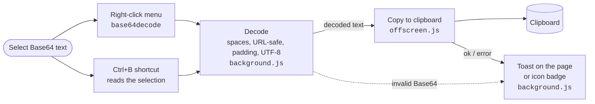

# Base64 Decode & Copy

**English** | [한국어](README.ko.md)

A Chrome extension that decodes a selected Base64 string with one right-click and copies the result to the clipboard.

## Features

- Select text, right-click → **base64decode** → the decoded result is copied to the clipboard
- Shortcut **Ctrl+B** (Mac: **Command+B**): decodes and copies the selected text right away (selections inside input boxes work too; change the key at `chrome://extensions/shortcuts`)
  - Note: in Google Docs, Gmail and similar sites this shortcut takes priority over Ctrl+B (bold). If they clash, pick another key at the address above.
- Shows a preview of the result at the bottom right of the page (red when it fails)
- Handles strings with line breaks or spaces, URL-safe Base64 (`-`, `_`) and missing `=` padding
- Decodes as UTF-8, so Korean and other non-ASCII text comes out correctly
- Collects no data and sends nothing anywhere

The notification messages are in Korean.

## Installation

> Requires Chrome 116 or later (uses `chrome.runtime.getContexts`)

1. Download or clone this repository.
2. Type `chrome://extensions` in the Chrome address bar.
3. Turn on **Developer mode** at the top right.
4. Click **Load unpacked** → select this folder.

## Files

| File | Role |
|---|---|
| `manifest.json` | Manifest V3 settings |
| `background.js` | Registers the right-click menu, decodes Base64, shows notifications |
| `offscreen.html` / `offscreen.js` | Copies to the clipboard (a service worker cannot write to the clipboard directly, so an offscreen document does it) |

## Structure

- A service worker has no DOM, so the offscreen document does the clipboard copy.
- The shortcut reads the selection in every frame with `chrome.scripting.executeScript`, and reads selections inside input boxes separately.
- Where a toast cannot be shown (such as `chrome://` pages), the extension icon badge shows `OK` or `ERR` instead.
